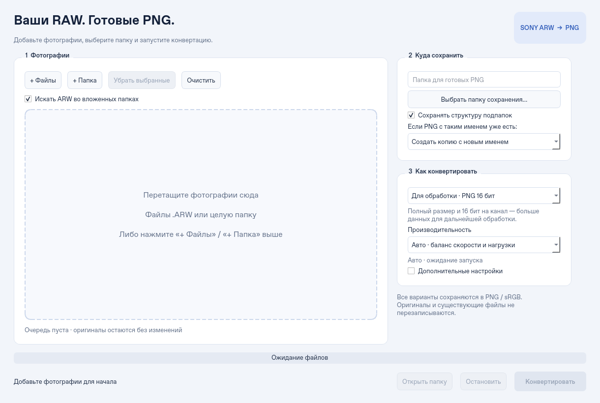

# ARW → PNG

Десктопное приложение для массовой конвертации Sony `.ARW` в PNG под Windows 10/11 (x64).
Python 3.12, Qt / PySide6, LibRaw / rawpy. Интерфейс на русском.



## Запуск из исходников на Windows

Установите Python 3.12 x64 с python.org. Откройте PowerShell в папке проекта:

```powershell
py -3.12 -m venv .venv
.\.venv\Scripts\python.exe -m pip install -r requirements.txt
.\.venv\Scripts\python.exe -m raw_to_png
```

## Использование

1. Добавьте файлы или папки кнопками либо перетащите их в окно.
2. В блоке «Куда сохранить» нажмите **«Выбрать папку сохранения…»**
   либо вставьте полный путь. Новая папка будет создана при запуске.
   Выберите, сохранять ли структуру подпапок или складывать PNG в одну папку.
3. В блоке «Как конвертировать» выберите готовый вариант или свои настройки.
4. Нажмите «Конвертировать». Ошибки отдельных файлов отображаются в очереди;
   остальные файлы продолжают обрабатываться.

Существующие PNG не перезаписываются. По умолчанию приложение подбирает имена с суффиксами
`(2)`, `(3)` и далее. Можно выбрать «Пропустить этот файл» при совпадении имён.
В режиме создания копий повторный запуск очереди создаёт новые PNG. Оригиналы
не изменяются. Смешанные папки объединяются в выбранном каталоге назначения;
совпадающие относительные имена также получают суффиксы.

Выделите строки и нажмите «Убрать выбранные», чтобы исключить фотографии из очереди.
Окно запоминает папку назначения и настройки после запуска конвертации.
Кнопка «Открыть папку» показывает выбранную папку в проводнике.

### Варианты конвертации

| Вариант | Глубина | Размер | Автоосветление |
| --- | --- | --- | --- |
| Для обработки (по умолчанию) | 16 бит на канал | Полный | Выключено |
| Для просмотра | 8 бит на канал | Полный | Включено |
| Быстро | 8 бит на канал | ½ ширины и высоты | Включено |
| Свои настройки | 8 или 16 бит | Полный или половинный | На выбор |

В «Дополнительных настройках» доступны баланс белого камеры, автоматический
или дневной свет; яркость от −2 до +2 EV (множитель 2^EV), автоматическое
осветление и половинный размер. Изменение любого параметра выбирает «Свои настройки».
Половинный размер использует быстрый режим демозаики LibRaw; это не извлечение JPEG-превью.
Для RAW, где LibRaw не уменьшает размер (например, sRAW), применяется усреднение блоков 2×2.

### Производительность

Доступны три режима — числовых настроек параллелизма в интерфейсе нет.

- **Авто** (по умолчанию) начинает с одного снимка. После успешных конвертаций
  добавляет задачи, до четырёх одновременно, оставляя одно доступное ядро системе.
  На двухъядерном компьютере обрабатывается одна фотография. Учитываются доступные
  CPU, привязка к ядрам и ограничения cgroup v2 в Linux.
- **Экономный** всегда обрабатывает одну фотографию за раз.
- **Максимальная скорость** постепенно увеличивает число задач до доступного
  количества CPU, пока это ускоряет обработку. Если дополнительные задачи
  не помогают, возвращается к более быстрому числу обработчиков.
  При выборе режима показывается подсказка: «Пока идёт конвертация на максимальной
  скорости, не используйте другие тяжёлые приложения».

Во всех режимах конвертация идёт в отдельных процессах. Для «Авто» и «Экономного»
на Windows задаётся приоритет **«Ниже среднего»**, на Linux — nice не ниже 5.
«Максимальная скорость» использует обычный приоритет Windows; Linux сохраняет
унаследованный приоритет не выше обычного. Высокий приоритет не используется. Интерфейс сохраняет
свой приоритет. Внутренние пулы OpenMP / BLAS ограничены одним потоком на процесс.
Пониженный приоритет уступает CPU другим программам, но не задаёт жёсткий процент CPU.

Перед обработкой читаются размеры RAW без распаковки сенсора. Для каждой задачи
закладывается консервативный бюджет памяти, учитывающий полное разрешение даже
при экспорте в 8 бит или половинный размер. Он уточняется вверх по измеренным
пикам. Планировщик оставляет минимум 1 ГиБ или 25% RAM системе (что больше),
учитывает ещё не выделенные буферы уже запущенных задач и проверяет свободную
память перед запуском новых. При недостатке RAM отображается «Ожидание свободной
памяти»; очередь возобновится после её освобождения. Можно остановить ожидание.
Если задача не помещается даже в общий бюджет, она получает ошибку.
Контроль памяти действует и в режиме «Максимальная скорость».

Это управление запуском, а не жёсткий системный лимит памяти: уже запущенные
задачи заканчиваются, а резкие изменения потребления RAM другими приложениями
непредсказуемы. При аварии рабочего процесса остальные файлы продолжают
обрабатываться. Каждый снимок использует новый процесс, освобождая его ресурсы
после завершения; в межпроцессную очередь передаются пути, а не изображения.

Отмена проверяется до чтения,
после обработки LibRaw и при записи строк PNG; прервать сам вызов LibRaw нельзя.
При отмене временный файл удаляется, завершённые PNG сохраняются.
Во время финального копирования текущий PNG завершается перед остановкой.

Цвет: sRGB с соответствующей отметкой PNG, демозаика LibRaw; по умолчанию
баланс белого камеры и без автоматического осветления. Ориентация берётся из RAW. 16 бит — на каждый
из трёх каналов RGB. Это проявленный PNG с кривой sRGB, не линейный RAW.
Результат может отличаться от JPEG камеры и фирменных Sony Creative Looks.
EXIF, GPS и прочие метаданные камеры в PNG не копируются. Новые модели камер
поддерживаются в пределах установленной версии LibRaw.

## Сборка приложения без установленного Python

На Windows с Python 3.12 выполните:

```powershell
powershell -ExecutionPolicy Bypass -File .\build-windows.ps1
```

По умолчанию создаётся **тестовая** сборка с включённой диагностикой.
Финальная сборка с выключенной по умолчанию диагностикой:

```powershell
powershell -ExecutionPolicy Bypass -File .\build-windows.ps1 -Channel release
```

В GitHub Actions выбирайте `channel: test` или `channel: release`.
Профиль сборки добавляется как отдельный ресурс; исходники приложения не переписываются.

Запускайте `dist\ARW-to-PNG\ARW-to-PNG.exe`. Для переноса на другой компьютер
нужна **вся папка** `ARW-to-PNG`, не только exe. Сборка не подписана цифровой
подписью. Также доступна ручная GitHub Actions-сборка `Windows desktop build`:
после загрузки кода в GitHub запустите workflow и скачайте артефакт.
Для распространения учитывайте лицензии Qt (LGPLv3), LibRaw и остальных зависимостей;
библиотеки Qt остаются отдельными файлами в папке сборки.

## Отчёты проверки

В тестовой сборке отчёты включены автоматически. В финальной сборке и при запуске
из исходников — выключены. Включить или отключить можно через
«Дополнительные настройки → Записывать отчёт проверки» перед началом очереди.
Выбор действует в текущем сеансе и не переносится из тестовой сборки в финальную.

После завершения или остановки нажмите **«Сохранить отчёт»**. Получится один JSON,
который можно передать для проверки. Он содержит настройки, версии библиотек,
ОС/CPU/RAM, время файлов, CPU и память группы процессов, изменение параллелизма,
ожидание памяти и категории ошибок. Файлы обозначаются номерами строк очереди.
Фотографии, EXIF, имена файлов, полные пути и тексты исключений в отчёт не попадают.
Автоматической отправки нет.

Отчёт записывается локально при старте, затем примерно каждые пять секунд, при
ошибках и завершении. В Windows автоматические копии лежат в
`%LOCALAPPDATA%\RawToPng\diagnostics`, в Linux — в каталоге данных пользователя
`RawToPng/diagnostics`. Хранятся последние десять отчётов. Каждый ограничен первыми
2000 записями файлов и последними 3600 замерами; общие итоги учитывают всю очередь,
а пропуски подробных записей явно отмечены. Если приложение аварийно закрылось,
можно взять последний JSON из этой папки: его состояние останется `running`.

CPU и сумма RSS основного и дочерних процессов измеряются примерно раз в секунду.
100% CPU в отчёте означает все доступные CPU; сумма RSS может повторно учитывать
общие страницы библиотек. Это выборочные замеры, а не точный системный максимум.
Пиковая память каждого рабочего процесса дополнительно берётся из ОС.
Ошибка автоматической записи отчёта не останавливает конвертацию — готовый отчёт
остаётся доступен для сохранения в другую папку.

## Разработка и проверки в Linux / облаке

Используйте существующий checkout `/workspace/raw-to-png`; отдельный worktree не нужен.

```bash
python -m venv .venv
.venv/bin/python -m pip install -r requirements-dev.txt
QT_QPA_PLATFORM=offscreen .venv/bin/python -m pytest -q
.venv/bin/python -m raw_to_png
```

Для окна требуется графическая сессия и системные библиотеки Qt. В среде без
дисплея используйте `QT_QPA_PLATFORM=offscreen` только для проверки интерфейса.
Сквозной тест с внешним реальным RAW:

```bash
RAW_TO_PNG_SAMPLE=/path/to/photo.ARW QT_QPA_PLATFORM=offscreen .venv/bin/python -m pytest -q
```

Тесты проверяют точность 8/16-битного PNG, вложенные папки, коллизии имён,
защиту от перезаписи, отмену, повреждённые RAW, продолжение после падения процесса,
лимиты CPU/RAM, ожидание памяти, пониженный приоритет Windows и настройки интерфейса.
Без `RAW_TO_PNG_SAMPLE` тест реального RAW пропускается. Windows-сборку необходимо
проверять на Windows; Linux не создаёт Windows exe.
